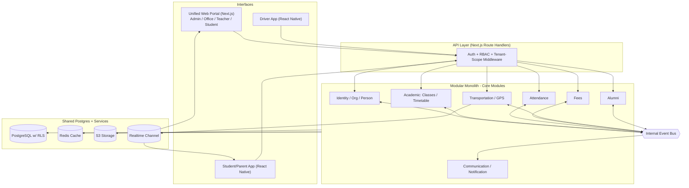
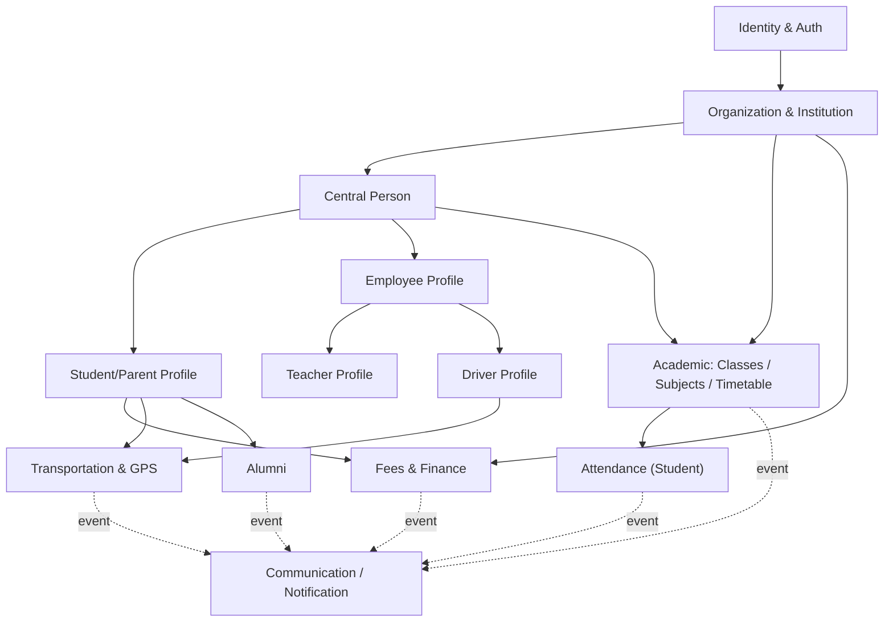
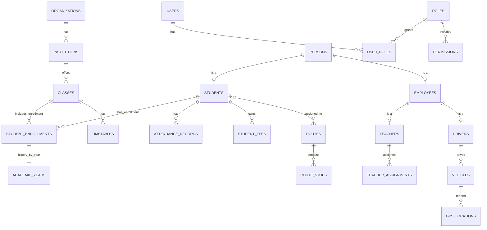
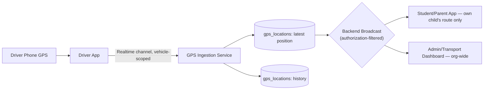

# Architecture — Unified Education Institution Management Platform

**Status:** Draft for review — no module gets implemented until its slice of this document is signed off (Architecture-First principle, carried into `agent context/Ai Workflow.md` §1).
**Supersedes:** the previous `agent context/architecture.md` (BGS Teachers Portal microservices doc), preserved below as **§1 — Current State**.
**Companion docs:** `agent context/Ai Workflow.md` (how modules get built against this contract), `agent context/progress-tracker.md` (what's actually done).

---

## 0. Scope

This document defines the target architecture for evolving BGS's current systems into the full **Unified Education Institution Management Platform**: one centralized, multi-tenant system covering schools, PU colleges, and degree colleges — students, staff, transport, fees, communication, and alumni — under a single identity model.

---

## 1. Current State (As-Built)

The existing footprint is broader than one microservices doc covers. As of this draft:

| Piece | Stack | Notes |
|---|---|---|
| Core Teachers Portal | Unified React SPA (Vite) + Supabase (Postgres + Auth) | Attendance, marks, syllabus, reports, meetings — Postgres RLS |
| Transportation service | Node/Express, **JSON file storage** | Routing, vehicle assignment, fee tracking |
| AOB/Alumni service | Node/Express, **SQLite** | Alumni registry, audit logs, communications |
| Teacher Weekly Task Portal | React/Node, **MySQL**, Google OAuth | Separate stack; PRD complete, scaffolding begun |
| Mark Entry module | Built via Antigravity | Create test → enter marks per student → print results, scoped by stream (Science/Commerce) × year × class |
| Academic analytics / reporting | — | Multi-test PDF reports for JEE, NEET, PCMB CET, PCMCs CET batches; navy/gold styling, tier segmentation, absentee-exclusion methodology |
| Institutional design system | Canva | Event invitations, timetable posters, result posters, signage — navy/gold visual language |
| School website | Static HTML artifact | Multi-page, School/PU College division switcher |
| Decentralized campus administration | Design only | Formalized as a PDF for management, not yet implemented as software |

**The problem this architecture solves:** four different data stores (Postgres, JSON, SQLite, MySQL) and no central `Person` model means the same driver, teacher, or student can exist in more than one place with no single source of truth, and RBAC can't be enforced centrally across all of it. That's the gap between "several good tools exist" and "one platform exists."

---

## 2. Target Architecture Overview

**Pattern:** Modular Monolith (per product direction — avoid premature microservices), one shared PostgreSQL database, multi-tenant from day one via `organization_id` / `institution_id` scoping, modules communicating through an internal event bus rather than direct cross-imports.



**Interfaces:** Admin, Office, Teacher, and Student portals are role-based views inside **one** Next.js app (continuing the existing "unified shell" pattern that already works), not multiple separate apps — that avoids re-wiring auth/session/design-system multiple times. Student/Parent and Driver get their own React Native apps because their needs genuinely differ (push notifications, background GPS, offline queuing).

---

## 3. Core Concept — Central Identity

Every person exists once. Profiles hang off a single `persons` record instead of being re-created per module.

```text
Person
├── Student/Parent Profile
├── Employee Profile
│    ├── Teacher Profile
│    └── Driver Profile
└── Management Profile
```

Auth is layered on top, not merged into it. A single `auth.users` record explicitly links to exactly one `persons` record via a 1:1 `user_id` mapping. Role assignment and deduplication consistently resolve through this mapping:

```text
Auth User (Supabase) [1:1 users.id = persons.user_id] → Person → Student/Parent / Employee / Teacher / Driver
```

---

## 4. Multi-Tenant Architecture

```text
Organization
├── School (Primary / High School)
├── PU College (1st PUC / 2nd PUC)
└── Degree College (Departments / Courses)
```

- **Model chosen:** shared schema, single database. Organizations map 1:N to Institutions. Business-level tables carry `institution_id`, while organization-level configurations carry `organization_id`. Every org-scoped user, role, and permission strictly follows this boundary.
- **Isolation:** Postgres Row-Level Security policies scope every query to the `institution_id`/`organization_id` claim in the caller's JWT using a shared RLS predicate that resolves the tenant through this ancestry.
- **Future path:** if a future institution needs isolation beyond RLS, migrate that tenant to schema-per-tenant — the `institution_id` column makes this a data-partitioning exercise, not a rewrite.

---

## 5. RBAC & Permission Model

Never hardcode permissions in application code:

```text
User → Role → Permission (with scope: own / class / department / institution / organization)
```

Illustrative matrix (F = full, S = scoped, V = view-only, – = none):

| Role | Org/Inst Setup | Person/Identity | Student Records | Staff/HR | Attendance | Timetable | Fees | Transport/GPS | Communication | Alumni | Reports |
|---|---|---|---|---|---|---|---|---|---|---|---|
| Super Admin | F | F | F | F | F | F | F | F | F | F | F |
| Org Admin | S (own org) | F | F | F | F | F | F | F | F | F | F |
| Institution Admin/Principal | V | S (own inst.) | S | S | S | S | S | S | S | S | S |
| Office Admin | – | S | F (own inst.) | V | S | V | S | – | S | – | S |
| Accounts/Finance Staff | – | V | V | – | – | – | F (own inst.) | – | S | – | S (fees) |
| Teacher | – | V (self) | V (own classes) | V (self) | S (own classes) | V (own) | – | – | S | – | – |
| Driver | – | V (self) | V (assigned) | V (self) | – | – | – | S (own vehicle) | – | – | – |
| Student/Parent | – | V (self/children) | V (self/children) | – | V (self/children) | V (self/children) | V (self/children) | V (own route) | V | – | – |
| Alumni | – | V (self) | – | – | – | – | – | – | V | S (self) | – |

---

## 6. Migration Strategy (Strangler Fig)

The four existing stores in §1 are not thrown away — they're migrated module-by-module, in the order the roadmap already reaches them, so nothing stops working mid-transition.

| Service | Current storage | Migration trigger | Target |
|---|---|---|---|
| Transportation | JSON files | Start of Driver App / GPS work (Phase 6) | Postgres, `vehicles`/`routes`/`route_stops`/`driver_assignments`/`gps_locations` |
| AOB/Alumni | SQLite | Resumption of Alumni Dashboard work (Phase 8) | Postgres, `alumni` linked to `persons` |
| Teacher Weekly Task Portal | MySQL | Before Phase 4 (Academic System) begins, to avoid a second duplicate-person source | Postgres, folded into `teachers`/`teacher_assignments` |
| Mark Entry / Academic Analytics | Ad hoc (Antigravity-built) | Alongside Phase 4 Marks/Results work | Postgres, `student_enrollments` + results tables, keeping the existing stream/year/class scoping logic |

Until a row in this table is migrated, that service keeps running as-is and is called through an anti-corruption adapter contract. These adapters invoke the Transportation JSON, AOB/Alumni SQLite, Teacher Weekly Task Portal MySQL, and Mark Entry stores through the monolith event bus while preserving their existing behavior until migration. The adapter handles event/request schemas, ownership boundaries, retry/failure behavior, and idempotency to ensure zero-downtime hybrid operation. See `agent context/Ai Workflow.md` §5.2 for the migration template.

---

## 7. Module Dependency Map



Communication has no structural dependents — it only subscribes to events, so it can change or be replaced without touching any other module. This is what keeps "future AI or analytics features possible without changing the core attendance module" true in practice.

---

## 8. ER Diagram (core entities, simplified)



---

## 9. Database Schema (table inventory by module)

| Module | Tables |
|---|---|
| Org/Institution | `organizations`, `institutions` |
| Identity/Access | `users`, `roles`, `permissions`, `user_roles` |
| Person | `persons`, `students`, `employees`, `teachers`, `drivers` |
| Academic | `academic_years`, `classes`, `sections`, `subjects`, `departments`, `courses`, `student_enrollments`, `teacher_assignments`, `timetables` |
| Attendance | `attendance_records` |
| Finance | `fee_structures`, `student_fees`, `payments`, `receipts` |
| Transport | `vehicles`, `routes`, `route_stops`, `driver_assignments`, `gps_locations` |
| Alumni | `alumni` |
| Communication | `notifications`, `emails`, `announcements` |
| Platform | `audit_logs` |

Rule: every table above except `organizations` itself carries `institution_id` (or is reachable to one via foreign key), and every table with an owner references `persons.id`, never a duplicate name/contact field.

---

## 10. API Architecture

- Convention: `/api/<module>/<resource>` — one folder per module, mirroring §7.
- Every route runs the same middleware chain: **authenticate** (verify Supabase JWT) → **authorize** (check the §5 matrix via a shared `can(user, action, resource)` helper — never an inline `if (role === 'admin')`) → **tenant-scope** (inject `institution_id`/`organization_id` filter) → handler.
- **Cross-module calls permit typed module service/query interfaces** for synchronous request-time reads, authorization, validation, and transaction work. Events are kept strictly for asynchronous side effects and integrations. Example: Attendance emits `student.absent` to the event-bus for decoupled notifications. Start with an in-process emitter or Postgres `LISTEN/NOTIFY`; upgrade to Redis Streams or Supabase Queues once volume justifies it.
- Internal/service-only endpoints (biometric ingestion, GPS ingestion) require a service-role credential, never a user JWT.

---

## 11. Authentication Architecture

- Supabase Auth is the identity provider.
- On login, a Postgres trigger / Edge Function stamps custom JWT claims: `role`, `institution_id`, `organization_id`.
- RLS policies on every table key off these claims, failing-closed when required claims are missing.
- JWT Custom Claims refresh behavior: Sessions have a defined maximum lifetime. Tokens refresh periodically, and upon role or tenant changes, sessions/tokens are immediately revoked and forced to re-authenticate to propagate claims.
- The Supabase **service-role key** is used only in trusted backend jobs — never shipped to a client.


---

## 13. Realtime GPS Architecture



The backend is the sole authority: the driver app never sends location directly to a parent device. Map rendering uses OpenStreetMap/MapLibre to avoid per-load map billing.

---

## 14. Event-Driven Communication (examples)

| Event | Emitted by | Typical subscribers |
|---|---|---|
| `student.absent` | Attendance | Notification (parent SMS/WhatsApp/push), Admin dashboard |
| `fee.paid` | Fees | Notification (receipt), Reports |
| `student.graduated` | Academic | Alumni (auto-create alumni record), Notification |
| `vehicle.trip_started` | Transport | Notification (parent), Admin dashboard |

---

## 15. Folder Structure (target monorepo)

```text
bgs-platform/
├── apps/
│   ├── web/                 # Next.js unified portal (Admin/Office/Teacher/Student, role-based routing)
│   ├── parent-app/          # React Native + Expo
│   ├── driver-app/          # React Native + Expo
│   └── biometric-agent/     # .NET / C# Windows service
├── packages/
│   ├── db/                  # schema, migrations, seed data
│   ├── auth/                # Supabase client, RBAC helpers, JWT claim utils
│   ├── event-bus/           # module event emitter/listener contracts
│   ├── ui/                  # shared shadcn/ui components, design tokens
│   └── config/               # shared eslint/tsconfig/tailwind config
├── services/
│   ├── transportation-legacy/  # existing Node/Express service — see §6
│   └── aob-legacy/             # existing Node/Express AOB service — see §6
└── docs/
    ├── architecture.md
    ├── ai-workflow.md
    ├── progress-tracker.md
    └── ui-ux-design-prompt.md
```

---

## 16. Deployment

- **Web:** Vercel.
- **Database:** managed PostgreSQL (Supabase).
- **Cache:** Redis (Upstash).
- **Storage:** S3-compatible (Supabase Storage / Cloudinary where appropriate).
- **Mobile:** React Native + Expo, built/distributed via EAS.
- **Biometric agent:** signed Windows installer, distributed per-institution.

---

## 17. Decision Log

Every entry here needs sign-off before the module it affects gets built (per `ai-workflow.md` §1). Add new rows as decisions get made — don't overwrite history.

| Date | Decision | Rationale | Status |
|---|---|---|---|
| — | Update Global Theme to Maroon/Cream/Gold | The Institutional Design System was updated from Navy/Gold to a premium Maroon/Cream/Gold aesthetic globally across all admin and teacher portals to match new UI mockups. | Approved |
| — | Modular monolith over microservices for new work | Avoids premature operational overhead; existing Transport/AOB services stay as-is until migrated per §6 | Proposed — needs sign-off |
| — | Shared-schema multi-tenancy (not schema-per-tenant) | Cheapest fit for "one institution now, more later"; §4 documents the escape hatch | Proposed — needs sign-off |
| — | Teacher Weekly Task Portal (MySQL) migrates before Phase 4 starts, not after | Prevents a second duplicate-person source once Academic System work begins | Proposed — needs sign-off |